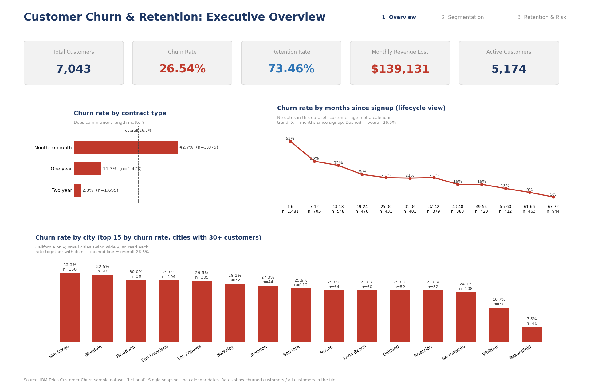
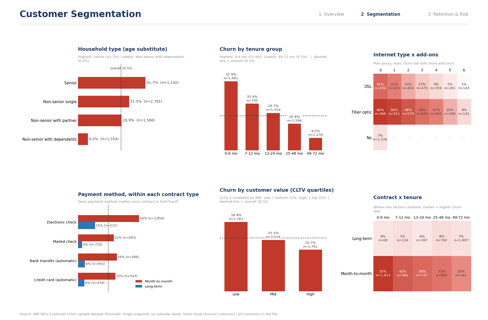
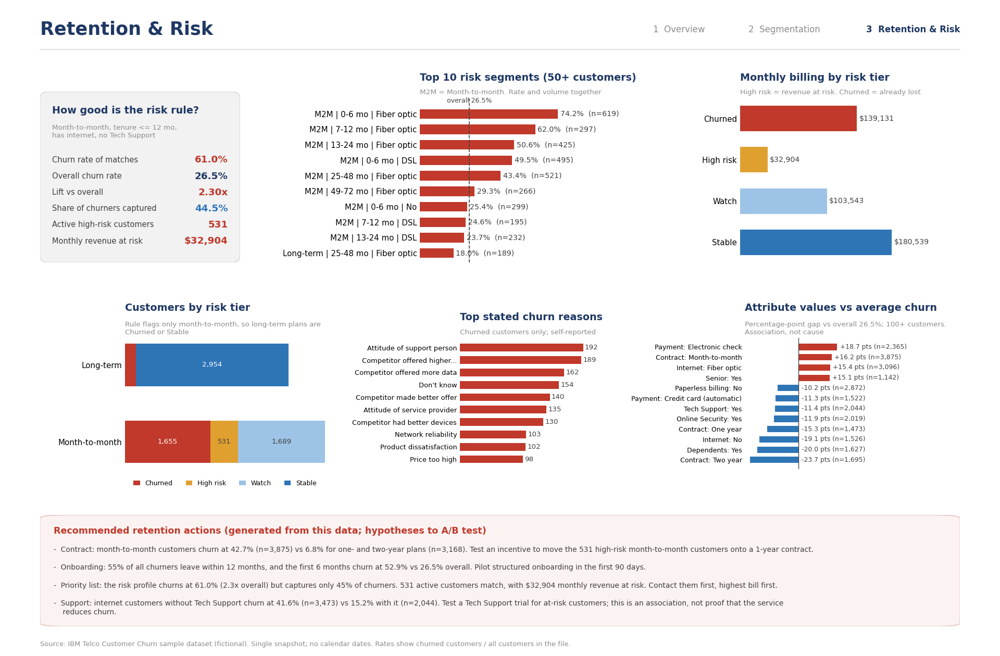

# Customer Churn & Retention Analytics Dashboard

An end-to-end analysis of customer churn for a subscription telecom business, using SQL, Excel and Tableau.
It measures how much revenue churn removes, finds where churn concentrates, and defines a rule-based list of
active customers to prioritise for retention.

> Status: replace every **[FILL]** with numbers from your own run. Nothing below is pre-computed.

## Business Problem
A subscription-based telecom company is losing customers. Management wants to know how large the problem is,
which customers and products are affected, what is associated with leaving, and where retention spend would
protect the most revenue.

## Objectives
- Measure churn rate, retention rate and monthly revenue lost
- Compare churn across contract, tenure, price, services, payment method, household type and city
- Identify the segments that contribute most to churn (rate and volume)
- Define a rule-based high-risk flag for active customers and test whether it beats chance
- Convert findings into specific, testable retention actions

## Dataset
IBM Telco Customer Churn (extended version): 7,043 customers, 33 variables, from IBM Cognos Analytics sample data.
Kaggle: https://www.kaggle.com/datasets/yeanzc/telco-customer-churn-ibm-dataset (not redistributed here; see `data/raw/README.md`).
Fictional telco in California, Q3. Target: `Churn Value` (1 = churned).

**Limitations:** no dates (so no calendar trend; a lifecycle view is used instead), no age (Senior Citizen + household used),
no plan / support-call / satisfaction fields (add-on count and Tech Support used as proxies), single snapshot.
Churn Score and CLTV are IBM-modelled; CLTV is used only for value segments. Full list: `docs/assumptions.md`.

## Tools
SQL (SQLite, bundled with Python; Postgres reference included) | Excel (formulas, summary tables, charts) | Tableau (3 dashboards) |
Python (pandas for cleaning, matplotlib for the dashboard images) | GitHub

## Repository
```
data/raw, data/cleaned     raw download instructions, cleaned CSVs, cleaning log
sql/                       features view + 22 queries (+ Postgres cleaning reference)
python/                    data_cleaning.py, run_sql.py, reconcile.py, build_excel.py, build_dashboards.py
excel/                     customer_churn_analysis.xlsx (generated)
tableau/                   build guide, calculated fields, .twbx (you create)
docs/                      data dictionary, KPI definitions, assumptions, insights, recommendations, checklist
tests/                     synthetic-data smoke test, Excel-vs-SQL verifier
screenshots/               dashboard images for this README
run_all.py                 one-command pipeline
```

## How to Run
```
pip install -r requirements.txt
python run_all.py --self-test     # setup check on synthetic data (results meaningless)
python run_all.py                 # real run (needs data/raw/Telco_customer_churn.xlsx)
```

## Data Cleaning
Checks and actions are logged in `data/cleaned/cleaning_log.csv`. Summary:
- Duplicate CustomerIDs: **[FILL]**
- Total Charges stored as text with blanks (**[FILL]** rows, expected for tenure 0) converted to numeric, blanks set to 0 (assumption)
- "No internet service" / "No phone service" merged into "No" for add-on counting
- Constant/duplicate columns removed (Count, Country, State, Lat Long, Churn Label)
- Churn Label vs Churn Value consistency checked: **[FILL]**

## Feature Engineering
Tenure group, charge group, household type, value segment (CLTV quartiles), contract category, add-on count,
revenue lost, risk profile and high-risk flag. Reasons: `docs/data_dictionary.md`.

## KPIs
| KPI | Value |
|---|---|
| Total customers | [FILL] |
| Active / churned customers | [FILL] / [FILL] |
| Churn rate / retention rate | [FILL] / [FILL] |
| MRR (active) | [FILL] |
| Monthly revenue lost (annualised, assumption) | [FILL] ([FILL]) |
| Average monthly charges / tenure | [FILL] / [FILL] |
| High-risk customers / monthly revenue at risk | [FILL] / [FILL] |

Definitions and rationale: `docs/kpi_definitions.md`. KPIs reconcile across pandas, SQL, Excel and Tableau.

## SQL Analysis
`sql/02_churn_analysis.sql`: overall churn, churn by gender / household / city / contract / plan proxy / payment method /
tenure / price, revenue lost, top risk segments, call list, retention by segment, lifecycle churn, churn reasons,
risk-rule back-test, and controlled comparisons (payment x contract, price x contract).

## Excel Analysis
`excel/customer_churn_analysis.xlsx`: Raw Data, Cleaned Data (derived columns as formulas), Calculations (KPIs),
Pivot Analysis (COUNTIFS/SUMIFS summary tables), Dashboard (KPI cards + charts), Cleaning Log, Read Me.

## Dashboards
Three pages: Executive Overview, Customer Segmentation, Retention & Risk. Generated reproducibly from the data by `python/build_dashboards.py` (matplotlib), so every number and recommendation traces back to the dataset. A Tableau version can be built from `tableau/TABLEAU_BUILD_GUIDE.md` (add the .twbx and link it here only if you build it).




## Key Insights
Fill from `docs/insights_template.md`. Report only what the data shows, with customer counts, and include hypotheses that did not hold.
1. **[FILL]**
2. **[FILL]**

## Business Recommendations
| Finding | Recommendation | Success metric |
|---|---|---|
| [FILL] | [FILL] | [FILL] |

Recommendations are hypotheses for A/B testing, not proven effects.

## Limitations
Observational, single-snapshot, fictional data; associations not causation; modelled fields (Churn Score, CLTV); no dates.

## Future Improvements
- Use a dataset with signup/cancellation dates for true monthly churn trends and cohort retention
- Survival analysis (Kaplan-Meier) of customer lifetime
- Validate recommendations with A/B-tested retention campaigns
- Compare the rule-based risk flag with a simple logistic regression benchmark

## Data source and credit
IBM Cognos Analytics sample data (Telco customer churn). Check the dataset's terms before redistributing the raw file.
